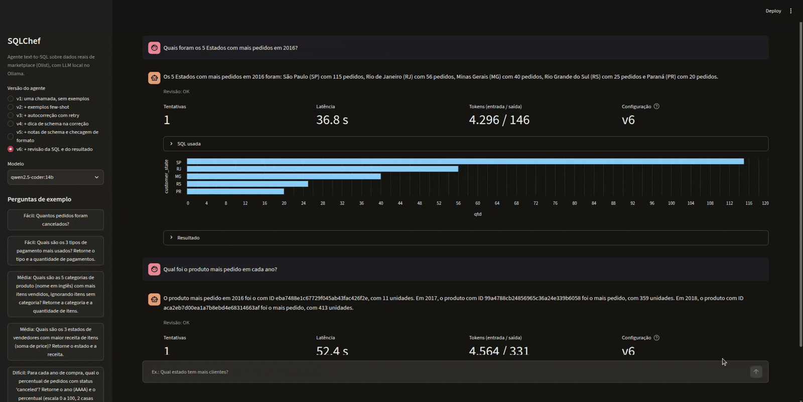

# SQLChef

Agente text-to-SQL que responde em português a perguntas sobre dados reais de um marketplace brasileiro (dataset público da [Olist](https://www.kaggle.com/datasets/olistbr/brazilian-ecommerce)). Ele lê o schema, gera uma consulta SQL, executa em um SQLite somente leitura, corrige a própria consulta quando algo dá errado e responde mostrando a SQL usada.

O projeto tem duas partes: o **agente** (seis versões, cada uma acrescentando uma técnica) e uma **avaliação objetiva** com 100 perguntas, que mede o que cada técnica realmente melhora em dois modelos locais. A avaliação é, na prática, o resultado principal: o agente é pequeno, e o que se aprende vem de medir onde ele erra.

- [Como rodar](#como-rodar)
- [Demo](#demo)
- [Como o agente funciona](#como-o-agente-funciona)
- [Como o projeto foi desenvolvido](#como-o-projeto-foi-desenvolvido)
- [Experimentos](#experimentos)
- [Análise dos resultados](#análise-dos-resultados)
- [Limitações](#limitações)

## Como rodar

```bash
python -m venv .venv && source .venv/bin/activate
pip install -r requirements.txt
cp .env.example .env
python data/build_db.py        # baixa o dataset (kagglehub) e monta data/olist.db
```

O LLM roda localmente no [Ollama](https://ollama.com/download), sem custo de API:

```bash
curl -fsSL https://ollama.com/install.sh | sh
ollama pull qwen2.5-coder:7b
python -m agent.sql_agent "Quantos pedidos foram cancelados?"
```

Configuração no `.env` (ou no ambiente):

| Variável | Padrão | Uso |
|---|---|---|
| `OLLAMA_MODEL` | `qwen2.5-coder:7b` | modelo usado |
| `OLLAMA_HOST` | `http://localhost:11434` | endereço do Ollama |
| `OLLAMA_NUM_CTX` | `8192` | janela de contexto |
| `AGENT_VERSION` | `v3` | versão do agente (`v1` a `v6`) |
| `MAX_ATTEMPTS` | `3` | máximo de gerações por pergunta |

## Demo

```bash
streamlit run app.py
```

Interface em Streamlit sobre `answer()`: a pergunta vira SQL, a SQL roda no banco somente leitura e o modelo responde em português. Para cada resposta, a demo mostra a SQL usada (expansível), a tabela de resultado, um gráfico quando o resultado é rótulo + número, e as tentativas, a latência e os tokens. Na barra lateral dá para trocar a versão do agente (v1 a v6) e o modelo instalado no Ollama, e há perguntas de exemplo do conjunto de avaliação, incluindo uma que o 7B não resolve.



## Como o agente funciona

### Os dados

`data/build_db.py` monta `data/olist.db` a partir dos CSVs públicos da Olist, com sete tabelas: `customers`, `sellers`, `products`, `orders`, `order_items`, `order_payments` e `order_reviews`. Pequenos ajustes em relação aos CSVs: colunas com erro de grafia renomeadas, a tradução das categorias para inglês incorporada a `products`, strings vazias viram `NULL`, datas ficam como texto `AAAA-MM-DD HH:MM:SS`, e a tabela de geolocalização (1 milhão de linhas) não é carregada. O banco e os CSVs ficam fora do git por causa da licença do dataset.

O schema tem armadilhas de propósito deixadas como estão, porque são o que torna as perguntas difíceis: um pedido pode ter vários itens, vários pagamentos e várias avaliações; o cliente real é `customer_unique_id` (o `customer_id` muda a cada pedido); e `order_item_id` é a posição do item no pedido, não uma quantidade.

### O fluxo

O agente é um grafo [LangGraph](https://www.langchain.com/langgraph) em `agent/sql_agent.py`:

```
 pergunta ─▶ gerar ─▶ executar ─┬─ erro / vazio / formato suspeito ─▶ corrigir ─▶ gerar (até MAX_ATTEMPTS)
                                ├─ (v6) SQL roda ─▶ revisar ─┬─ problema ─▶ corrigir ─▶ gerar
                                │                            └─ OK ─┐
                                └─ resultado aceito ───────────────┴─▶ finalizar ─▶ resposta
```

1. **Gerar.** O LLM recebe um prompt de sistema com as regras, o `CREATE TABLE` de cada tabela com três linhas de exemplo e, conforme a versão, exemplos few-shot e notas sobre o schema. Responde só com a consulta, dentro de um bloco ```` ```sql ````.
2. **Executar.** A SQL passa por `agent/db.py`, que aceita um único `SELECT` (ou `WITH ... SELECT`), abre o SQLite em modo somente leitura (`mode=ro` e `PRAGMA query_only`) e aborta consultas que passam de 10 s. A validação do texto é uma defesa em profundidade; a proteção de verdade é a conexão somente leitura. O agente corta o resultado em 50 linhas.
3. **Corrigir.** Se a execução deu erro, devolveu zero linhas ou só `NULL`, o problema volta ao LLM como nova mensagem da conversa, e ele escreve outra consulta. O limite padrão é de 3 gerações por pergunta.
4. **Responder.** Na demo, uma última chamada redige em português a resposta a partir do resultado. A SQL usada sempre é mostrada. A avaliação só usa a SQL gerada.

`agent/llm.py` isola o cliente do Ollama (temperatura 0, `num_ctx` configurável) e registra os tokens de cada chamada; trocar de modelo é só mudar `OLLAMA_MODEL`.

### As seis versões

Cada versão acumula as anteriores, para medir o efeito de cada técnica separadamente:

| Versão | O que muda |
|---|---|
| `v1` | uma chamada, sem exemplos |
| `v2` | + 7 exemplos few-shot (nenhum repete uma pergunta de teste) |
| `v3` | + autocorreção com retry: erro de execução ou resultado vazio volta ao LLM, até `MAX_ATTEMPTS` |
| `v4` | + dica de schema na correção: se a coluna não existe, a mensagem diz em quais tabelas ela está e mostra as colunas delas |
| `v5` | + notas de semântica do schema no prompt (o que identifica cada linha, onde há várias linhas por pedido, que `order_item_id` é posição e não quantidade, divisão inteira no SQLite) + checagem de formato: se a pergunta pede um único valor ("Quantos...") e voltaram várias linhas, o resultado vai para a correção mesmo sem erro |
| `v6` | + revisão: com a SQL rodando, o LLM, em um contexto separado do gerador, recebe a pergunta, a SQL e as primeiras linhas do resultado e responde `OK` ou `PROBLEMA: ...` seguindo uma lista de verificação (condições, entidade contada, nível de agregação, formato, plausibilidade). Um problema vai para a correção, com uma geração extra além de `MAX_ATTEMPTS`. Há uma revisão por pergunta, e se a SQL revisada falhar o agente volta ao resultado anterior |

## Experimentos

### Método

**Métrica: execution accuracy.** A SQL gerada e a SQL de referência são executadas no banco, e a resposta conta como certa se as duas devolvem o mesmo resultado. Regras de comparação (`eval/run_eval.py`):
- nomes de colunas são ignorados;
- floats são arredondados a 2 casas;
- a ordem das linhas só importa nas perguntas marcadas `ordered` (rankings); nas demais, as linhas são comparadas como conjunto;
- a ordem das colunas só importa nas perguntas marcadas `strict_columns`;
- colunas a mais ou a menos contam como erro, porque a pergunta diz o que retornar.

**Ambiente:** Ollama local com temperatura 0, GPU AMD Radeon (Navi 33, ~8 GB de VRAM), 15 GB de RAM. Modelos: `qwen2.5-coder:7b` e `qwen2.5-coder:14b`.

**Conjunto de teste:** 100 perguntas em português (25 fáceis, 45 médias, 30 difíceis) em `eval/questions.json`, cada uma com a SQL de referência. As 100 referências rodam e não vêm vazias (`--validate-gold`). As perguntas cobrem contagens e filtros simples, junções entre tabelas, agregações por grupo, médias por pedido, datas, negação e anti-join, pivô com `CASE`, funções de janela (`ROW_NUMBER`, `LAG`), `EXCEPT` e comparação entre períodos. Algumas foram redigidas com pistas que puxam para a coluna errada ("quantidade total de itens" sugere `SUM(order_item_id)`). Os exemplos few-shot não repetem nenhuma pergunta de teste.

```bash
python eval/run_eval.py --validate-gold
python eval/run_eval.py --agent agent.sql_agent:generate_sql_v6 --label qwen7b_v6_100
OLLAMA_MODEL=qwen2.5-coder:14b python eval/run_eval.py --agent agent.sql_agent:generate_sql_v6 --label qwen14b_v6_100
python eval/review_stats.py eval/results/qwen7b_v6_100.csv   # o que o revisor salvou, estragou ou não mudou
```

Resultados em `eval/results/<label>.csv` (por pergunta: acerto, SQL gerada, tentativas, tokens, latência) e `<label>_summary.json` (acurácia por dificuldade e a configuração da rodada).

### Resultados

Acertos por dificuldade nas 100 perguntas, com latência e tokens médios por pergunta. Cada pergunta foi rodada uma vez por configuração.

| Modelo | Versão | Fácil (25) | Média (45) | Difícil (30) | Total (100) | Latência | Tokens |
|---|---|---|---|---|---|---|---|
| qwen2.5-coder:7b | v1 | 24/25 | 37/45 | 7/30 | 68/100 (68,0%) | 1,2 s | 1.485 |
| qwen2.5-coder:7b | v2 | 24/25 | 40/45 | 6/30 | 70/100 (70,0%) | 1,1 s | 1.979 |
| qwen2.5-coder:7b | v3 | 24/25 | 42/45 | 7/30 | 73/100 (73,0%) | 1,4 s | 2.420 |
| qwen2.5-coder:7b | v4 | 24/25 | 43/45 | 7/30 | 74/100 (74,0%) | 1,7 s | 2.407 |
| qwen2.5-coder:7b | v5 | 24/25 | 43/45 | 9/30 | 76/100 (76,0%) | 1,7 s | 2.903 |
| qwen2.5-coder:7b | v6 | 24/25 | 43/45 | 9/30 | 76/100 (76,0%) | 2,5 s | 5.113 |
| qwen2.5-coder:14b | v1 | 25/25 | 41/45 | 10/30 | 76/100 (76,0%) | 7,4 s | 1.489 |
| qwen2.5-coder:14b | v2 | 25/25 | 42/45 | 14/30 | 81/100 (81,0%) | 6,5 s | 1.980 |
| qwen2.5-coder:14b | v3 | 25/25 | 43/45 | 14/30 | 82/100 (82,0%) | 6,9 s | 2.138 |
| qwen2.5-coder:14b | v4 | 25/25 | 43/45 | 15/30 | 83/100 (83,0%) | 6,7 s | 2.096 |
| qwen2.5-coder:14b | v5 | 25/25 | 43/45 | 23/30 | 91/100 (91,0%) | 7,2 s | 2.363 |
| qwen2.5-coder:14b | v6 | 25/25 | 43/45 | 25/30 | 93/100 (93,0%) | 8,2 s | 4.417 |

## Análise dos resultados

### O que cada técnica trouxe

Perguntas ganhas e perdidas em relação à versão anterior:

| Passo | 7B | 14B |
|---|---|---|
| v1 → v2 (few-shot) | +5, −3 | +8, −3 |
| v2 → v3 (autocorreção) | +3 | +1 |
| v3 → v4 (dica de schema) | +1 | +1 |
| v4 → v5 (notas + checagem de formato) | +4, −2 | +8 |
| v5 → v6 (revisor) | 0 | +2 |

- **Fáceis e médias saturam cedo.** O 14B acerta as 25 fáceis desde a v1, e os dois modelos chegam a 43 de 45 médias na v3 ou na v4. A partir daí, toda a diferença está nas difíceis.
- **Few-shot troca acertos.** Ele resolve perguntas novas, mas quebra outras que a v1 acertava (3 em cada modelo). No 14B é o maior ganho até a v4 (+5 no saldo); no 7B o saldo é de só +2.
- **A autocorreção ajuda pouco porque quase não é usada.** Na v3, só 14 perguntas do 7B e 4 do 14B passaram por uma segunda tentativa. Ela resolve o que o banco reporta (coluna inexistente, sintaxe, resultado vazio), e esse não é o erro que sobra. A dica de schema da v4 soma uma pergunta em cada modelo.
- **A v5 é a técnica que mais melhora as difíceis:** de 15 para 23 de 30 no 14B, sem perder nenhuma pergunta. No 7B, de 7 para 9, ganhando 4 e perdendo 2.
- **A v6 dá pouco e depende do modelo:** +2 no 14B, zero no 7B, e quase dobra os tokens.
- **O tamanho do modelo pesa tanto quanto as técnicas.** O 14B com a v1 empata com o 7B com a v5 (76/100). Mas o 7B responde em ~1 a 2,5 s por pergunta (mediana abaixo de 1,3 s), e o 14B em ~6,5 a 8 s. E as técnicas rendem muito mais no modelo maior: nas difíceis, o 14B vai de 10 para 25 de 30, e o 7B, de 7 para 9.
- **O que nenhuma versão resolve:** 20 perguntas o 7B não acerta em nenhuma versão; no 14B são só 5 (q19, q54, q57, q77, q90).

### Erros de SQL versus erros silenciosos

Quase todas as falhas que sobram são **erros silenciosos**: a SQL roda e devolve um resultado plausível, mas responde outra pergunta. Falhas da v6 nas 100 perguntas, por tipo:

| Tipo de erro | Exemplo | 7B | 14B |
|---|---|---|---|
| Leitura errada da pergunta: condição ignorada, "tanto em 2017 quanto em 2018" vira `IN ('2017', '2018')`, entidade contada errada (itens no lugar de pedidos, avaliações no lugar de pedidos), formato de resposta errado | "Quantos pedidos têm exatamente 3 itens?" (q76) | 9 | 1 |
| Agregação no nível errado: contar grupos sem subconsulta, média por linha de pagamento em vez do total por pedido, JOIN que repete valores | "Qual estado tem o maior ticket médio?" (q57) | 5 | 3 |
| `order_item_id` usado como quantidade de itens (a coluna é a posição do item no pedido) | "Qual a quantidade média de itens por pedido?" (q43) | 3 | 1 |
| Identificador do cliente: `customer_id` (muda a cada pedido) no lugar de `customer_unique_id` (cliente real), ou falta de `DISTINCT` | "Quantos clientes únicos são do RS?" (q65) | 2 | 1 |
| Funções de janela: ranking por grupo e `LAG` | "Qual a segunda categoria mais vendida em cada estado?" (q93) | 2 | 0 |
| Divisão inteira: no SQLite, inteiro dividido por inteiro descarta as casas decimais | "Qual foi o crescimento percentual de pedidos entre 2017 e 2018?" (q94) | 1 | 1 |
| SQL que não roda depois das tentativas (coluna inexistente, timeout) | q59, q97 | 2 | 0 |
| **Total** | | **24** | **7** |

Exemplo de erro ao contar grupos (q22), um dos erros silenciosos mais comuns antes da v5:

```sql
-- gerada: devolve uma linha "1" para cada pedido que atende à condição
SELECT COUNT(DISTINCT order_id) FROM order_items
GROUP BY order_id HAVING COUNT(DISTINCT seller_id) > 1

-- correta: conta os grupos
SELECT COUNT(*) FROM (
  SELECT order_id FROM order_items
  GROUP BY order_id HAVING COUNT(DISTINCT seller_id) > 1
)
```

### O que a v5 mudou

A v5 ataca os erros silenciosos sem chamada extra ao LLM:
- **Notas de semântica do schema.** O `CREATE TABLE` mostra nomes e tipos, mas não diz que um pedido pode ter vários pagamentos, que estado e `customer_unique_id` só existem em `customers`, nem que `order_item_id` é posição. As notas dizem isso em poucas linhas gerais, sem citar perguntas do teste.
- **Checagem de formato do resultado.** Se a pergunta começa com "Quantos" (sem "cada") ou o resultado é uma coluna numérica vinda de um `GROUP BY`, e voltaram várias linhas, o resultado vai para a correção com a instrução de envolver o `GROUP BY` em uma subconsulta. A regra não marca nenhuma das respostas de referência.

**No 14B**, a v5 ganhou oito perguntas e não perdeu nenhuma. Cinco são de contar grupos (q22, q60, q75, q76, q78), resolvidas já na primeira geração pela nota "envolva o `GROUP BY ... HAVING` em uma subconsulta". Na q80 o frete passou a ser somado por pedido em uma subconsulta antes do JOIN, como a nota pede. O ganho vem das notas, não da checagem: só 2 perguntas passaram por nova tentativa na v5 (contra 4 na v4). As notas acrescentam ~400 tokens ao prompt.

**No 7B**, ganhou q17 e q19 (as notas resolvem a ligação com `customers`), q60 e q75 (a checagem de formato pega a contagem de grupos e o modelo corrige), e perdeu q51 e q100. A q51 oscila entre rodadas também nas versões anteriores (ver Limitações).

**As notas funcionaram quando dizem qual padrão de SQL usar** (subconsulta com `HAVING`, `COUNT(*)` para itens, somar por pedido antes de juntar) **e foram ignoradas quando o modelo precisa perceber sozinho que está no nível de agregação errado.** Mesmo o 14B continua errando a divisão inteira (q43, apesar da nota), a média por linha de pagamento (q57, q77) e o JOIN de itens com pagamentos que duplica as somas (q54). No 7B, a maior parte das falhas é de leitura da pergunta, que as notas não cobrem: o modelo responde uma pergunta parecida com a feita.

### O que a v6 mudou (o revisor)

A v6 testa se o próprio modelo consegue pegar os erros silenciosos que sobram, revisando a SQL e o resultado contra a pergunta.

**No 7B**, medido com `eval/review_stats.py`:

| Revisor (7B, 100 perguntas) | Perguntas |
|---|---|
| Revisadas (a SQL rodou) | 97 |
| Apontou problema | 9 |
| Apontou problema numa resposta certa | 0 |
| Resposta errada → certa depois da revisão | 0 |
| Resposta errada que ele aprovou | 12 |
| Resposta errada sem revisão (a SQL dava erro ou voltava vazia) | 3 |

- **Quando o revisor aponta um problema, ele acerta.** As 9 respostas marcadas estavam todas erradas, e as descrições batem com o erro real ("não verifica se os clientes fizeram pedidos tanto em 2017 quanto em 2018", q50; "não considera os meses de janeiro a agosto", q94).
- **Mas o 7B não consegue corrigir o que o revisor apontou.** Nenhuma das 9 virou acerto. Em uma (q51) a SQL corrigida falhou e o agente voltou à anterior.
- **E ele aprova a maioria dos erros**, inclusive os que as notas descrevem: `SUM(order_item_id)` como quantidade (q90) e o JOIN que duplica a receita (q98).
- **Custo:** uma chamada a mais por pergunta, com o schema e as notas no prompt do revisor: +0,8 s e de ~2.900 para ~5.100 tokens por pergunta. Para o 7B, a revisão não compensa: ela sabe diagnosticar alguns erros, mas o mesmo modelo não sabe consertá-los.

**No 14B**, a revisão salvou 2 perguntas (q56 e q98) e não estragou nenhuma. O revisor apontou problema em só 4 das 100 respostas: 2 salvas e 2 que não ajudaram (q77 e q96, que continuam erradas), ou seja, sem falsos alarmes. O total vai de 91 para 93, ao custo de quase o dobro de tokens (2.363 → 4.417). Com 2 perguntas de diferença, é um resultado indicativo, não conclusivo.

## Limitações

- **100 perguntas é pouco.** Cada pergunta vale 1 ponto percentual. Diferenças de uma ou duas perguntas entre versões (por exemplo, a v6 contra a v5 no 14B) não são conclusivas.
- **Temperatura 0 não garante resultado idêntico.** Em rodadas repetidas, o 14B deu os mesmos acertos; no 7B uma pergunta (a q51) oscila entre certa e errada. Cada configuração foi rodada uma vez, então essa variação não está medida.
- **O conjunto não é inédito para as técnicas.** As notas da v5 e a lista de verificação do revisor foram escritas depois de ver as falhas das versões anteriores em parte destas perguntas. Uma técnica nova precisaria ser medida em perguntas novas.
- **Perguntas, notas e revisor foram escritos pela mesma pessoa.** Quem escreve as perguntas sabe quais armadilhas o agente conhece.
- **Erros silenciosos continuam sendo o ponto fraco.** O agente corrige o que o banco reporta, mas não sabe, sozinho, que uma SQL que roda está respondendo outra pergunta. As regras da v5 e o revisor da v6 pegam só parte deles; sobram principalmente os de granularidade (média por linha de pagamento, JOIN que duplica valores) e, no 7B, os de leitura da pergunta.
- **O revisor é do mesmo modelo que o gerador.** No 7B ele diagnostica alguns erros, mas não os conserta e aprova a maioria dos errados; no 14B ele quase não se manifesta. Um revisor mais forte que o gerador não foi testado.
- **A SQL das respostas certas pode não ser a ideal.** A métrica compara resultados, não a consulta: uma SQL correta por acaso, ou ineficiente, conta como acerto. E a execução tem timeout de 10 s, sem otimização.
- **Latência do modelo maior.** O 14B leva ~6,5 a 8 s por pergunta em média, com picos de ~47 s nesta máquina, o que pesa para uma demo interativa. Os números de latência não são comparáveis com outra máquina.
- **Um único banco, um único dialeto e dois modelos da mesma família.** Nada aqui diz como o agente se sai em outro schema, em outro dialeto SQL (por exemplo PostgreSQL) ou com modelos de outras famílias.
- **A demo não foi publicada.** Ela roda localmente com o Ollama; o deploy ainda não foi feito.
